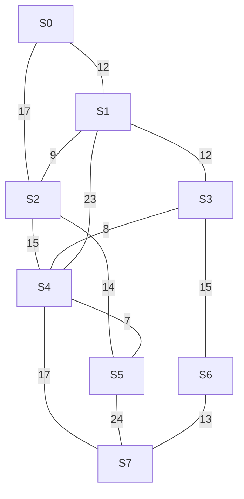

# Smart Grid — Otimização de Redes Elétricas

## 1. Objetivo

O projeto modela uma rede elétrica formada por oito subestações e treze ramais bidirecionais. O objetivo é encontrar rotas de menor custo, analisar o impacto de falhas na rede e identificar uma árvore geradora mínima.

A atividade utiliza um grafo não orientado e ponderado, com pesos definidos a partir do Registro Acadêmico (RA).

## 2. Parâmetros do problema

- **RA:** 510197
- **Dígitos:** D1 = 5, D2 = 1, D3 = 0, D4 = 1, D5 = 9, D6 = 7
- **Origem:** S0
- **Destino:** S6
- **Vértices:** S0, S1, S2, S3, S4, S5, S6 e S7
- **Arestas:** 13
- **Tipo:** grafo não orientado e ponderado

O destino é S6 porque o último dígito do RA é ímpar.

## 3. Modelagem do grafo

### 3.1. Pesos dos ramais

| Aresta | Ramal | Peso |
|---|---|---:|
| e1 | S0 – S1 | 12 km |
| e2 | S0 – S2 | 17 km |
| e3 | S1 – S2 | 9 km |
| e4 | S1 – S3 | 12 km |
| e5 | S2 – S4 | 15 km |
| e6 | S2 – S5 | 14 km |
| e7 | S3 – S4 | 8 km |
| e8 | S3 – S6 | 15 km |
| e9 | S4 – S5 | 7 km |
| e10 | S4 – S7 | 17 km |
| e11 | S5 – S7 | 24 km |
| e12 | S6 – S7 | 13 km |
| e13 | S1 – S4 | 23 km |



### 3.2. Matriz de adjacência

A matriz representa os custos dos ramais entre as subestações. Como o grafo é não orientado, ela é simétrica. O valor NULO indica que não existe conexão direta entre dois vértices.

|  | S0 | S1 | S2 | S3 | S4 | S5 | S6 | S7 |
|---|---:|---:|---:|---:|---:|---:|---:|---:|
| **S0** | — | 12 | 17 | NULO | NULO | NULO | NULO | NULO |
| **S1** | 12 | — | 9 | 12 | 23 | NULO | NULO | NULO |
| **S2** | 17 | 9 | — | NULO | 15 | 14 | NULO | NULO |
| **S3** | NULO | 12 | NULO | — | 8 | NULO | 15 | NULO |
| **S4** | NULO | 23 | 15 | 8 | — | 7 | NULO | 17 |
| **S5** | NULO | NULO | 14 | NULO | 7 | — | NULO | 24 |
| **S6** | NULO | NULO | NULO | 15 | NULO | NULO | — | 13 |
| **S7** | NULO | NULO | NULO | NULO | 17 | 24 | 13 | — |

## 4. Teste de mesa — Dijkstra

O algoritmo parte de S0 e atualiza as menores distâncias conhecidas para os demais vértices. Em caso de empate, é fechado primeiro o vértice de menor índice.

| Iteração | Fechado | L[S0] | L[S1] | L[S2] | L[S3] | L[S4] | L[S5] | L[S6] | L[S7] |
|---|---|---:|---:|---:|---:|---:|---:|---:|---:|
| Inicial | — | 0 | ∞ | ∞ | ∞ | ∞ | ∞ | ∞ | ∞ |
| 1 | S0 | [0] | 12 | 17 | ∞ | ∞ | ∞ | ∞ | ∞ |
| 2 | S1 | [0] | [12] | 17 | 24 | 35 | ∞ | ∞ | ∞ |
| 3 | S2 | [0] | [12] | [17] | 24 | 32 | 31 | ∞ | ∞ |
| 4 | S3 | [0] | [12] | [17] | [24] | 32 | 31 | 39 | ∞ |
| 5 | S5 | [0] | [12] | [17] | [24] | 32 | [31] | 39 | 55 |
| 6 | S4 | [0] | [12] | [17] | [24] | [32] | [31] | 39 | 49 |
| 7 | S6 | [0] | [12] | [17] | [24] | [32] | [31] | [39] | 49 |

### Antecessores atualizados

- Inicialização: distância de S0 igual a 0.
- Iteração 1: Ant[S1] = S0; Ant[S2] = S0.
- Iteração 2: Ant[S3] = S1; Ant[S4] = S1.
- Iteração 3: Ant[S4] = S2; Ant[S5] = S2.
- Iteração 4: Ant[S6] = S3.
- Iteração 5: Ant[S7] = S5.
- Iteração 6: Ant[S7] = S4.

Na iteração 4, o caminho até S4 por S3 também teria custo 32 km. Como a atualização só ocorre quando a nova distância é estritamente menor, o antecessor de S4 permanece S2.

A ordem de fechamento é:

**S0 → S1 → S2 → S3 → S5 → S4 → S6**

A rota mínima até o destino é:

**S0 → S1 → S3 → S6**

Custo total: **39 km**.

## 5. Análise de contingência

A contingência considera a falha do ramal e5, que conecta S2 a S4. Para simular essa situação, a aresta é removida do grafo e o Dijkstra é executado novamente.

A rota mínima permanece:

**S0 → S1 → S3 → S6**

| Indicador | Resultado |
|---|---:|
| Custo original | 39 km |
| Custo após a falha | 39 km |
| Acréscimo | 0 km |
| Acréscimo percentual | 0% |

A falha não altera a rota escolhida porque o caminho mínimo entre S0 e S6 não utiliza o ramal S2–S4.

## 6. Árvore Geradora Mínima — Prim

O algoritmo de Prim seleciona arestas de menor peso para conectar todos os vértices, sem formar ciclos.

A árvore geradora mínima encontrada é composta pelas seguintes arestas:

| Aresta | Peso |
|---|---:|
| S4 – S5 | 7 km |
| S3 – S4 | 8 km |
| S1 – S2 | 9 km |
| S0 – S1 | 12 km |
| S1 – S3 | 12 km |
| S6 – S7 | 13 km |
| S3 – S6 | 15 km |
| **Total** | **76 km** |

A AGM conecta as oito subestações com sete arestas, utilizando o menor custo total possível.

O custo da AGM não deve ser confundido com a soma das menores distâncias calculadas pelo Dijkstra. O Dijkstra considera caminhos mínimos a partir de uma origem específica. Já o Prim busca conectar todos os vértices com o menor custo total, sem exigir que cada caminho individual parta de S0.

Neste caso, a soma das distâncias mínimas a partir de S0 é **204 km**, enquanto o custo da AGM é **76 km**. A união dos caminhos mínimos a partir de S0 não garante uma árvore de custo mínimo, pois esses caminhos são escolhidos individualmente para alcançar cada destino, e não para minimizar o custo total da rede.

## 7. Implementação

O projeto está dividido em três arquivos:

- `main.py`: instanciação da rede, execução dos algoritmos e exibição dos resultados.
- `algoritmos.py`: implementação dos algoritmos de Dijkstra e Prim.
- `README.md`: documentação da atividade e registro do desenvolvimento.

O NetworkX é utilizado para representar o grafo. Os algoritmos de Dijkstra e Prim foram implementados separadamente.

### Execução

Instale a dependência:

```bash
pip install networkx
```

Na raiz do projeto, execute:

```bash
python main.py
```

A saída apresenta a matriz de adjacência, as distâncias e os antecessores de cada iteração, a ordem de fechamento, a rota mínima, a análise de contingência e o resultado de Prim.

## 8. Devlog

### Planejamento

A primeira etapa foi analisar o enunciado. O grafo foi representado com NetworkX, enquanto Dijkstra e Prim foram implementados manualmente em `algoritmos.py`, separados da instanciação da rede em `main.py`. Os pesos foram calculados pelas fórmulas do RA 510197 e conferidos antes de serem inseridos no código.

### Decisões de implementação

- **Desempate:** o Dijkstra fecha o vértice aberto de menor L[v] e, em caso de empate, o de menor índice.
- **Atualização:** distância e antecessor só mudam quando o novo custo é estritamente menor.
- **Parada:** o algoritmo termina ao fechar o destino (S6), como no teste de mesa.
- **Contingência:** a falha de e5 é simulada em uma cópia do grafo, sem alterar o original.
- **Validação:** pesos negativos são rejeitados na criação das arestas.

### Dificuldades

O ponto mais delicado foi o empate em S4. Na iteração 4, o caminho por S3 (24 + 8) também resulta em 32 km, igual ao valor já obtido por S2. Foi necessário usar a comparação estrita (`<`) para que Ant[S4] permanecesse S2, como no teste de mesa. Outro ponto foi a ordem de fechamento: S5 (31 km) é fechado antes de S4 (32 km), apesar de ter índice maior, pois o critério principal é a menor distância e o índice só desempata.

### Validação (código × teste de mesa)

A saída do programa foi comparada com a tabela da seção 4. As distâncias L[v] de cada iteração, os antecessores e a ordem de fechamento (S0, S1, S2, S3, S5, S4, S6) são idênticos. O custo mínimo de 39 km e a rota S0 → S1 → S3 → S6 também coincidem.

### Evidências de execução

Saída real de `python main.py`:

```text
MATRIZ DE ADJACÊNCIA
     S0  S1  S2  S3  S4  S5  S6  S7
  S0     —    12    17     —     —     —     —     —
  S1    12     —     9    12    23     —     —     —
  S2    17     9     —     —    15    14     —     —
  S3     —    12     —     —     8     —    15     —
  S4     —    23    15     8     —     7     —    17
  S5     —     —    14     —     7     —     —    24
  S6     —     —     —    15     —     —     —    13
  S7     —     —     —     —    17    24    13     —

DIJKSTRA

Tabela de execução:

Iteração 1 - vértice fechado: S0
Distâncias:
S0: 0 | S1: 12 | S2: 17 | S3: ∞ | S4: ∞ | S5: ∞ | S6: ∞ | S7: ∞ | 
Antecessores:
S0: None | S1: S0 | S2: S0 | S3: None | S4: None | S5: None | S6: None | S7: None | 

Iteração 2 - vértice fechado: S1
Distâncias:
S0: 0 | S1: 12 | S2: 17 | S3: 24 | S4: 35 | S5: ∞ | S6: ∞ | S7: ∞ | 
Antecessores:
S0: None | S1: S0 | S2: S0 | S3: S1 | S4: S1 | S5: None | S6: None | S7: None | 

Iteração 3 - vértice fechado: S2
Distâncias:
S0: 0 | S1: 12 | S2: 17 | S3: 24 | S4: 32 | S5: 31 | S6: ∞ | S7: ∞ | 
Antecessores:
S0: None | S1: S0 | S2: S0 | S3: S1 | S4: S2 | S5: S2 | S6: None | S7: None | 

Iteração 4 - vértice fechado: S3
Distâncias:
S0: 0 | S1: 12 | S2: 17 | S3: 24 | S4: 32 | S5: 31 | S6: 39 | S7: ∞ | 
Antecessores:
S0: None | S1: S0 | S2: S0 | S3: S1 | S4: S2 | S5: S2 | S6: S3 | S7: None | 

Iteração 5 - vértice fechado: S5
Distâncias:
S0: 0 | S1: 12 | S2: 17 | S3: 24 | S4: 32 | S5: 31 | S6: 39 | S7: 55 | 
Antecessores:
S0: None | S1: S0 | S2: S0 | S3: S1 | S4: S2 | S5: S2 | S6: S3 | S7: S5 | 

Iteração 6 - vértice fechado: S4
Distâncias:
S0: 0 | S1: 12 | S2: 17 | S3: 24 | S4: 32 | S5: 31 | S6: 39 | S7: 49 | 
Antecessores:
S0: None | S1: S0 | S2: S0 | S3: S1 | S4: S2 | S5: S2 | S6: S3 | S7: S4 | 

Iteração 7 - vértice fechado: S6
Distâncias:
S0: 0 | S1: 12 | S2: 17 | S3: 24 | S4: 32 | S5: 31 | S6: 39 | S7: 49 | 
Antecessores:
S0: None | S1: S0 | S2: S0 | S3: S1 | S4: S2 | S5: S2 | S6: S3 | S7: S4 | 

Ordem de fechamento:
S0 -> S1 -> S2 -> S3 -> S5 -> S4 -> S6

Antecessores finais:
S0: None
S1: S0
S2: S0
S3: S1
S4: S2
S5: S2
S6: S3
S7: S4

Menor caminho:
S0 -> S1 -> S3 -> S6
Custo mínimo: 39 km

Soma das distâncias mínimas a partir de S0: 204 km

CONTINGÊNCIA - FALHA DO RAMAL e5
Novo caminho: S0 -> S1 -> S3 -> S6
Novo custo: 39 km
Aumento: 0 km
Aumento percentual: 0.00%

ÁRVORE GERADORA MÍNIMA - PRIM
S0 - S1: 12 km
S1 - S2: 9 km
S1 - S3: 12 km
S3 - S4: 8 km
S4 - S5: 7 km
S3 - S6: 15 km
S6 - S7: 13 km
Custo total da AGM: 76 km

COMPARAÇÃO
Soma das distâncias de Dijkstra: 204 km
Custo da árvore geradora mínima: 76 km
```