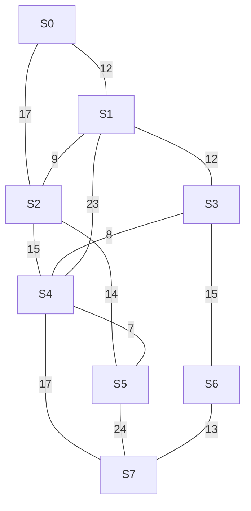

# Smart Grid — Otimização de Redes Elétricas

## 1. Objetivo

O projeto modela uma rede elétrica formada por oito subestações e treze ramais bidirecionais. O objetivo é encontrar rotas de menor custo, analisar o impacto de falhas na rede e identificar uma árvore geradora mínima.

A atividade utiliza um grafo não orientado e ponderado, com pesos definidos a partir do Registro Acadêmico (RA).

## 2. Parâmetros do problema

- **RA:** 510197
- **Dígitos:** D1 = 5, D2 = 1, D3 = 0, D4 = 1, D5 = 9, D6 = 7
- **Origem:** S0
- **Destino:** S6
- **Vértices:** S0, S1, S2, S3, S4, S5, S6 e S7
- **Arestas:** 13
- **Tipo:** grafo não orientado e ponderado

O destino é S6 porque o último dígito do RA é ímpar.

## 3. Modelagem do grafo

### 3.1. Pesos dos ramais

| Aresta | Ramal | Peso |
|---|---|---:|
| e1 | S0 – S1 | 12 km |
| e2 | S0 – S2 | 17 km |
| e3 | S1 – S2 | 9 km |
| e4 | S1 – S3 | 12 km |
| e5 | S2 – S4 | 15 km |
| e6 | S2 – S5 | 14 km |
| e7 | S3 – S4 | 8 km |
| e8 | S3 – S6 | 15 km |
| e9 | S4 – S5 | 7 km |
| e10 | S4 – S7 | 17 km |
| e11 | S5 – S7 | 24 km |
| e12 | S6 – S7 | 13 km |
| e13 | S1 – S4 | 23 km |



### 3.2. Matriz de adjacência

A matriz representa os custos dos ramais entre as subestações. Como o grafo é não orientado, ela é simétrica. O valor NULO indica que não existe conexão direta entre dois vértices.

|  | S0 | S1 | S2 | S3 | S4 | S5 | S6 | S7 |
|---|---:|---:|---:|---:|---:|---:|---:|---:|
| **S0** | — | 12 | 17 | NULO | NULO | NULO | NULO | NULO |
| **S1** | 12 | — | 9 | 12 | 23 | NULO | NULO | NULO |
| **S2** | 17 | 9 | — | NULO | 15 | 14 | NULO | NULO |
| **S3** | NULO | 12 | NULO | — | 8 | NULO | 15 | NULO |
| **S4** | NULO | 23 | 15 | 8 | — | 7 | NULO | 17 |
| **S5** | NULO | NULO | 14 | NULO | 7 | — | NULO | 24 |
| **S6** | NULO | NULO | NULO | 15 | NULO | NULO | — | 13 |
| **S7** | NULO | NULO | NULO | NULO | 17 | 24 | 13 | — |

## 4. Teste de mesa — Dijkstra

O algoritmo parte de S0 e atualiza as menores distâncias conhecidas para os demais vértices. Em caso de empate, é fechado primeiro o vértice de menor índice.

| Iteração | Fechado | L[S0] | L[S1] | L[S2] | L[S3] | L[S4] | L[S5] | L[S6] | L[S7] |
|---|---|---:|---:|---:|---:|---:|---:|---:|---:|
| Inicial | — | 0 | ∞ | ∞ | ∞ | ∞ | ∞ | ∞ | ∞ |
| 1 | S0 | [0] | 12 | 17 | ∞ | ∞ | ∞ | ∞ | ∞ |
| 2 | S1 | [0] | [12] | 17 | 24 | 35 | ∞ | ∞ | ∞ |
| 3 | S2 | [0] | [12] | [17] | 24 | 32 | 31 | ∞ | ∞ |
| 4 | S3 | [0] | [12] | [17] | [24] | 32 | 31 | 39 | ∞ |
| 5 | S5 | [0] | [12] | [17] | [24] | 32 | [31] | 39 | 55 |
| 6 | S4 | [0] | [12] | [17] | [24] | [32] | [31] | 39 | 49 |
| 7 | S6 | [0] | [12] | [17] | [24] | [32] | [31] | [39] | 49 |

### Antecessores atualizados

- Inicialização: distância de S0 igual a 0.
- Iteração 1: Ant[S1] = S0; Ant[S2] = S0.
- Iteração 2: Ant[S3] = S1; Ant[S4] = S1.
- Iteração 3: Ant[S4] = S2; Ant[S5] = S2.
- Iteração 4: Ant[S6] = S3.
- Iteração 5: Ant[S7] = S5.
- Iteração 6: Ant[S7] = S4.

Na iteração 4, o caminho até S4 por S3 também teria custo 32 km. Como a atualização só ocorre quando a nova distância é estritamente menor, o antecessor de S4 permanece S2.

A ordem de fechamento é:

**S0 → S1 → S2 → S3 → S5 → S4 → S6**

A rota mínima até o destino é:

**S0 → S1 → S3 → S6**

Custo total: **39 km**.

## 5. Análise de contingência

A contingência considera a falha do ramal e5, que conecta S2 a S4. Para simular essa situação, a aresta é removida do grafo e o Dijkstra é executado novamente.

A rota mínima permanece:

**S0 → S1 → S3 → S6**

| Indicador | Resultado |
|---|---:|
| Custo original | 39 km |
| Custo após a falha | 39 km |
| Acréscimo | 0 km |
| Acréscimo percentual | 0% |

A falha não altera a rota escolhida porque o caminho mínimo entre S0 e S6 não utiliza o ramal S2–S4.

## 6. Árvore Geradora Mínima — Prim

O algoritmo de Prim seleciona arestas de menor peso para conectar todos os vértices, sem formar ciclos.

A árvore geradora mínima encontrada é composta pelas seguintes arestas:

| Aresta | Peso |
|---|---:|
| S4 – S5 | 7 km |
| S3 – S4 | 8 km |
| S1 – S2 | 9 km |
| S0 – S1 | 12 km |
| S1 – S3 | 12 km |
| S6 – S7 | 13 km |
| S3 – S6 | 15 km |
| **Total** | **76 km** |

A MST conecta as oito subestações com sete arestas, utilizando o menor custo total possível.

O custo da MST não deve ser confundido com a soma das menores distâncias calculadas pelo Dijkstra. O Dijkstra considera caminhos mínimos a partir de uma origem específica. Já o Prim busca conectar todos os vértices com o menor custo total, sem exigir que cada caminho individual parta de S0.


## 7. Implementação

O projeto está dividido em três arquivos Python:

- `algoritmos.py`: implementação dos algoritmos de Dijkstra e Prim.
- `main.py`: instanciação da rede e execução dos algoritmos.

### Execução

Na raiz do projeto, execute:

```bash
python main.py
```

A saída deve apresentar a matriz de adjacência, a rota mínima, a ordem de fechamento dos vértices, o resultado de Prim e a análise da contingência.

## 8. Devlog

### Planejamento inicial

A primeira etapa foi analisar o enunciado e o material disponibilizado pelo professor. A implementação foi dividida em três arquivos para separar a estrutura do grafo, os algoritmos e a execução.

Também foi definido que os resultados computacionais seriam comparados com o teste de mesa de Dijkstra.

### Próximas etapas

- Executar o programa e conferir a saída.
- Comparar os resultados do código com o teste de mesa.
- Registrar dificuldades encontradas durante a implementação e como foram resolvidas.
- Adicionar evidências da execução no repositório.